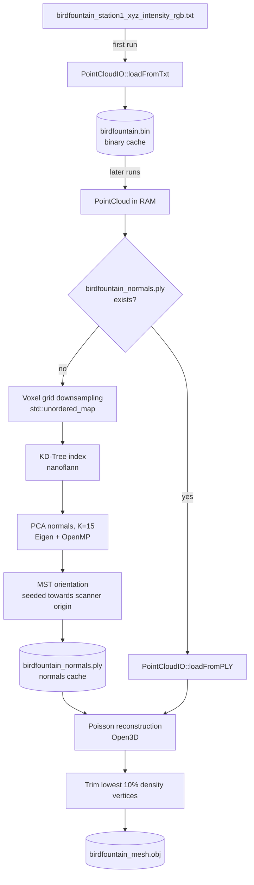

# Meshing a Terrestrial Laser Scan in C++

A C++ pipeline that turns a raw terrestrial laser scan into a triangle mesh. It runs on the `birdfountain_station1` scene from the [Semantic3D](http://www.semantic3d.net/) benchmark (about 40 million points) and covers binary caching, voxel grid downsampling, KD-Tree neighbour search, PCA normal estimation, MST normal orientation and Poisson surface reconstruction.

The design decisions, parameter study and limitations are explained in detail in the accompanying Medium post: **[Meshing a Terrestrial Laser Scan](https://medium.com/p/78309e303649)**.

## Pipeline



## Code Structure

| File | Role |
|---|---|
| `main.cpp` | Entry point. Loads the cloud, runs the pipeline and reports the processing time. |
| `PointCloud.hpp` | Plain structs (`PointData`, `NormalData`, `PointCloud`) holding flat `std::vector`s, following Data Oriented Design. |
| `PointCloudIO.hpp/.cpp` | Text parsing, binary cache (`.bin`) and ASCII PLY read/write. |
| `Reconstructor.hpp/.cpp` | Downsampling, KD-Tree adaptor, PCA, MST propagation and Poisson meshing. |
| `nanoflann.hpp` | Bundled single header KD-Tree library. |

## Requirements

- A C++17 compiler with OpenMP support (developed with MSVC on Windows)
- CMake
- [Open3D](https://www.open3d.org/) C++ library, used for Poisson reconstruction and mesh export
- [Eigen 3](https://eigen.tuxfamily.org/), used for the covariance eigendecomposition (the Open3D C++ package ships with it)
- [nanoflann](https://github.com/jlblancoc/nanoflann), already included in the repository

Poisson reconstruction at high depth is memory hungry. The results in the post were produced on a workstation with 128 GB of RAM, and depths above 16 did not complete. Open3D's Poisson solver runs on the CPU, so a GPU is not required.

## Data

Download `birdfountain_station1_xyz_intensity_rgb` from the Semantic3D benchmark and extract the `.txt` file into a `data/` folder at the repository root. Each line holds seven values: `x y z intensity r g b`.

```
tls-surface-reconstruction/
├── data/
│   └── birdfountain_station1_xyz_intensity_rgb.txt
└── ...
```

## Build and Run

```bash
cmake -S . -B out/build/release -DCMAKE_BUILD_TYPE=Release -DOpen3D_DIR=<open3d_install>/CMake
cmake --build out/build/release --config Release
cd out/build/release
./BirdfountainRecon
```

All paths are relative to the working directory and default to `../../../data/`, which matches Visual Studio's default `out/build/<preset>/` layout. If you run the executable from somewhere else, update the paths in `main.cpp` and `Reconstructor.cpp`.

The program takes no arguments. The final mesh is written to `data/birdfountain_mesh.obj` and can be opened in MeshLab, CloudCompare or Blender.

## Parameters

Parameters are compile time constants in `Reconstructor.cpp`.

| Parameter | Default | Description |
|---|---|---|
| `VOXEL_SIZE` | `0.01f` (1 cm) | Edge length of a voxel in the downsampling grid |
| `K_NEIGHBOURS` | `15` | Neighbours used for PCA and MST propagation |
| KD-Tree leaf size | `15` | Maximum points per leaf node |
| `depth` | `13` | Poisson octree depth. Depth 13 gave the best quality to cost ratio on this scene |
| Density trim | `0.10` | Fraction of lowest density vertices removed after reconstruction |

## Caches

The pipeline writes two caches into `data/` to avoid repeating expensive steps:

- **`birdfountain.bin`** is a raw binary dump of the parsed points. It reduces startup from minutes to under a second. It is a direct memory copy of `PointData`, so it is not portable across platforms or compilers.
- **`birdfountain_normals.ply`** stores the downsampled points with their oriented normals. If this file exists, downsampling, KD-Tree construction, PCA and MST are skipped entirely.

**Delete `birdfountain_normals.ply` whenever you change `VOXEL_SIZE` or `K_NEIGHBOURS`**, otherwise the old normals are silently reused.

## Known Limitations

- Poisson works well on the building facade but performs poorly on vegetation, since a tree crown is not the boundary of a solid. See the post for the full discussion and possible alternatives.
- MST seeds are oriented towards the scanner origin at `(0, 0, 0)`, which assumes a single station in scanner local coordinates.
- File paths and parameters are hardcoded.

## References

- Hackel, T., et al. "Semantic3d.net: A new large-scale point cloud classification benchmark." arXiv:1704.03847 (2017).
- Hoppe, H., et al. "Surface reconstruction from unorganized points." SIGGRAPH (1992).
- Kazhdan, M., Bolitho, M., and Hoppe, H. "Poisson surface reconstruction." Eurographics Symposium on Geometry Processing (2006).
- Blanco, J. L., and Rai, P. K. "nanoflann: a C++ header-only fork of FLANN." (2014).
